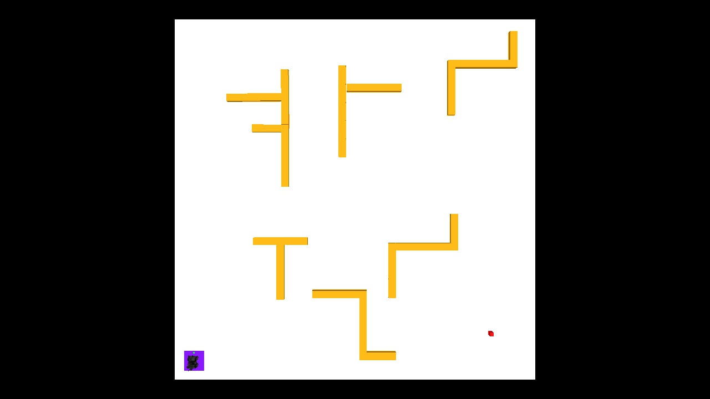
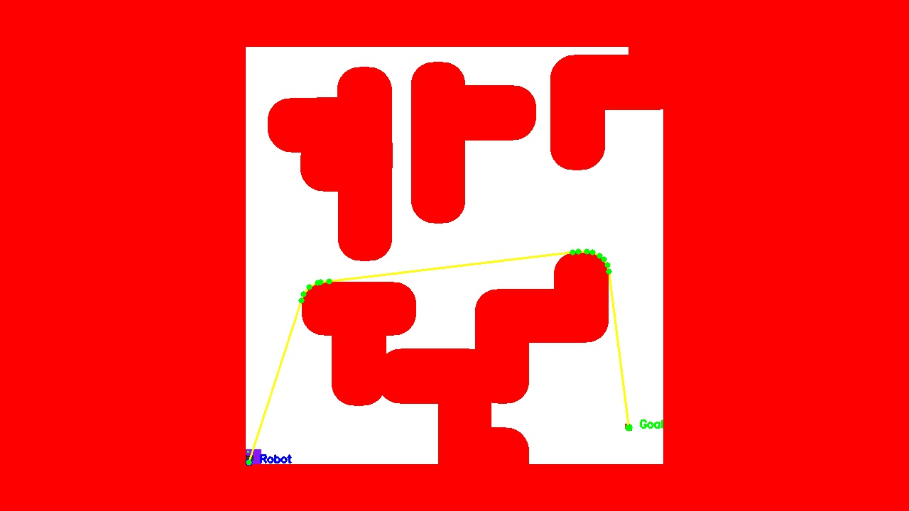
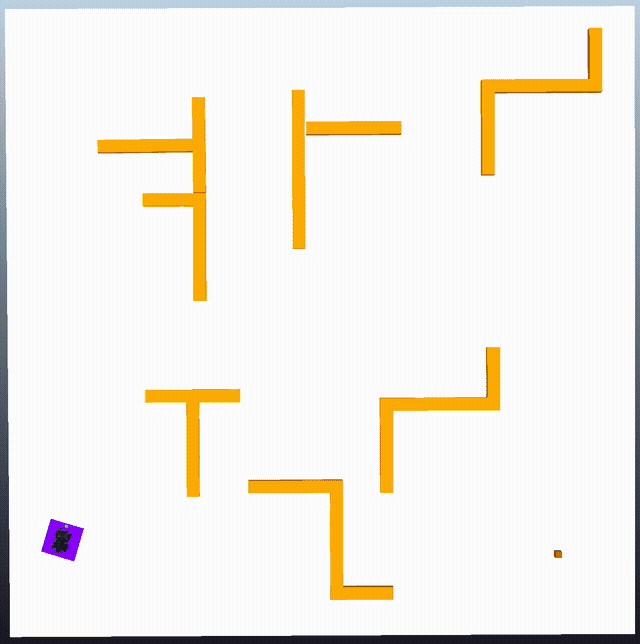

# Vision-based robot navigation

A Robotics course project at Università della Svizzera Italiana (February–June 2025).
A RoboMaster navigates a simulated environment using a fixed overhead camera,
OpenCV color segmentation, an occupancy grid, and A* planning. Camera feedback
controls its heading and position; updated maps trigger replanning when needed.

| Overhead camera | Planned route and obstacle clearance |
| --- | --- |
|  |  |

[](docs/media/moving-obstacles.mp4)

[Watch or download the full 50-second MP4](docs/media/moving-obstacles.mp4)
· [Project presentation](docs/presentation.pdf)

## Try the vision demo

Python 3.10 or newer, from this directory:

```bash
python3 -m venv .venv
source .venv/bin/activate
pip install -r requirements.txt
python -m robomaster_example.demo examples/overhead.jpg --margin 6 --output outputs/path.jpg
```

The repository includes the source, scene, and example media. ROS, CoppeliaSim,
and the course simulator plugins are external dependencies.

The demo saves a planned route from one recorded frame. To run the robot, see
[ROS 2 and CoppeliaSim setup](docs/simulation.md).

## Code

- `map_processor.py`: HSV marker detection and obstacle inflation for the robot footprint.
- `path_planner.py`: A* without diagonal corner cutting and collision-checked path simplification.
- `robomaster_controller_node.py`: camera-feedback waypoint following and replanning.
- `demo.py`: image-to-route command, independent of ROS.

Source files are in `robomaster_example/`; the historical ROS package name is retained.
Tests: `python -m unittest discover -s tests -v` (controller tests need ROS).

## Scope and credits

Tested locally with ROS 2 Humble, CoppeliaSim 4.7, Python 3.10, OpenCV 4.6, and
NumPy 1.26. The updated controller reached the goal in the supplied dynamic scene.
The linked video is original course footage, recorded before the controller updates.

The vision system assumes a fixed camera, a bright floor, a purple robot marker,
a green heading marker, and a red goal. Marker loss or stale images stop the robot.
These scene-specific assumptions limit transfer to other environments.

Navigation project built on the
[USI RoboMaster course framework](https://github.com/idsia-robotics/robotics-lab-usi-robomaster).
External simulator and ROS dependencies have their own licenses.

Automated checks run the recorded-frame demo, marker detection, and planning on
Python 3.10 and 3.12. Controller tests run when ROS is available; CI does not launch
the simulator.
